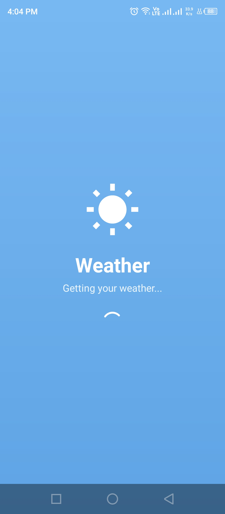
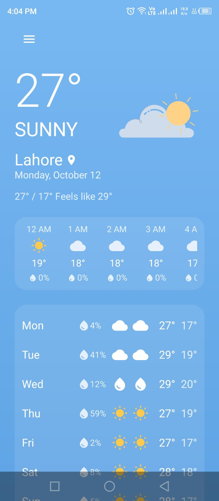
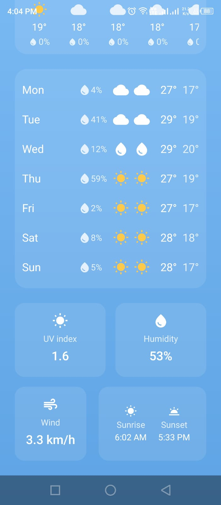

# 🌦️ Weather App

A weather forecasting Android application built with **Kotlin and Jetpack Compose**. The app integrates the Open-Meteo API to retrieve weather information and provides a clean interface for viewing current weather conditions and forecasts.

## 📸 Screenshots

<p align="center">
   
  
  
</p>

## ✨ Features

* 🌡️ **Current Weather:** View current weather conditions and temperature.
* 📅 **Weekly Forecast:** Check weather predictions for the upcoming week.
* 📍 **Location-Based Weather:** Retrieve device location for relevant weather information.
* 🌐 **API Integration:** Fetch weather data from the Open-Meteo API.
* 🔄 **UI State Management:** Handle loading, success, and error states.
* 🔐 **Location Permissions:** Request and handle location permissions.
* ☁️ **Weather Visualization:** Display weather conditions in an easy-to-understand interface.

## 🛠️ Tech Stack

* **Language:** Kotlin
* **UI Framework:** Jetpack Compose
* **Architecture:** MVVM
* **State Management:** ViewModel and StateFlow
* **Asynchronous Programming:** Kotlin Coroutines
* **Networking:** Retrofit
* **Weather Data:** Open-Meteo API
* **Location Services:** Google Play Services Location
* **IDE:** Android Studio

## 🏗️ Architecture

The application uses the Model-View-ViewModel (MVVM) architecture to separate UI rendering, state management, and data retrieval.

```text
Compose UI
    |
    v
 ViewModel
    |
    v
 Repository
    |
    v
 Retrofit API Service
    |
    v
 Open-Meteo API
```

* **UI Layer:** Displays weather information using Jetpack Compose.
* **ViewModel:** Manages UI state and coordinates data requests.
* **Repository:** Organizes weather data retrieval.
* **API Service:** Handles network requests through Retrofit.
* **Location Services:** Retrieves device location when the necessary permissions are granted.

## 🌐 API

This project uses the [Open-Meteo API](https://open-meteo.com/) for weather forecast data.

* [API Documentation](https://open-meteo.com/en/docs)
* [Open-Meteo Website](https://open-meteo.com/)

## 🚀 Getting Started

### Prerequisites

* Android Studio
* Android SDK compatible with the project
* Android emulator or physical Android device
* Internet connection
* Location permission for location-based functionality

### Installation

1. Clone the repository:

   ```bash
   git clone https://github.com/Maira-Riaz/WeatherApp.git
   ```

2. Open the project in Android Studio.

3. Allow Gradle to synchronize the project dependencies.

4. Run the app on an emulator or a connected Android device.

## 📚 What I Learned

* Building Android applications with Kotlin and Jetpack Compose.
* Implementing MVVM architecture.
* Managing UI state using ViewModel and StateFlow.
* Integrating REST APIs using Retrofit.
* Handling asynchronous operations with Kotlin Coroutines.
* Working with device location and runtime permissions.
* Managing loading and error states in an Android application.

## 👩‍💻 Author

**Maira Riaz**

Software Engineer | Android Development | Kotlin & Jetpack Compose

* GitHub: [Maira-Riaz](https://github.com/Maira-Riaz)
* Portfolio: [View Portfolio](https://mairariaz-portfolio.vercel.app)
